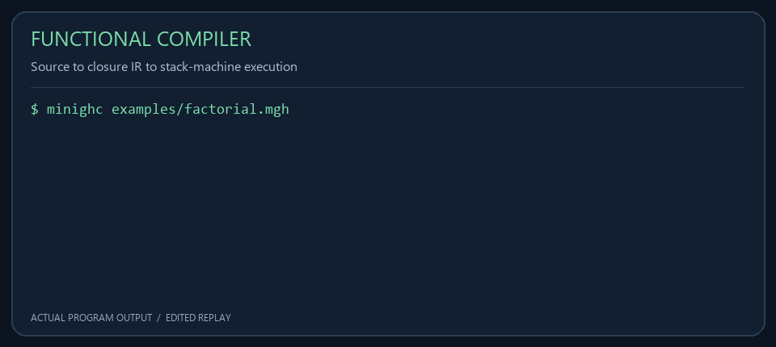
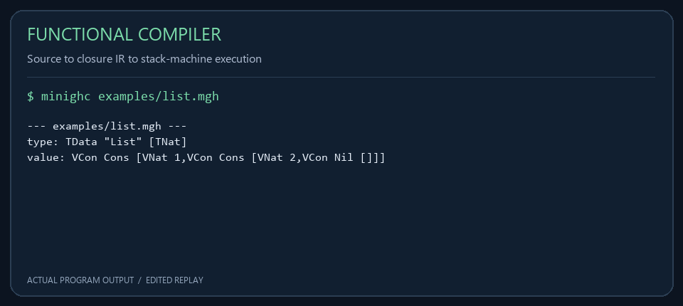

<div align="center">

# Functional Compiler & Exact Calculi

**A readable functional-language compiler, an executable closure machine, and a library of mathematical calculi.**

Haskell · MiniGHC 0.9 · BSD-3-Clause

[](https://github.com/AHMADALIPARR/minighc/actions/workflows/test.yml?query=branch%3Arepair%2Fcomplete-modules) [](#architecture) [](#architecture) [](LICENSE)



<sub>Actual program output, rendered as a compact replay. Animation timing is edited.</sub>

</div>

---

MiniGHC brings parsing, type checking, intermediate representations, lexical closures, and execution into a codebase that can be inspected end to end. Its mathematical modules cover rational polynomials, classical type calculi, exterior algebra, Schubert intersections, and operational calculus. The compiler and library are useful together, but their interfaces remain explicit: a mathematical module does not silently become a new phase of the compiler.

The project implements its own small language. The package name and `MiniGHC.*` namespaces identify this project; they do not imply compatibility with the complete Glasgow Haskell Compiler, its optimizer, or its runtime system.

**Navigate:** [Quick start](#quick-start) · [Architecture](#architecture) · [Language](#language) · [Mathematical library](#mathematical-library) · [Validation](#validation) · [Project layout](#project-layout)

## Quick start

Install GHC 8.8 or newer. The direct build uses the standard `base` and `containers` libraries and does not require downloading a framework.

```sh
git clone https://github.com/AHMADALIPARR/minighc.git
cd minighc
sh test.sh
```

The script builds the regression executable, runs it, builds the CLI, executes the bundled examples, and checks the additional calculus modules. Build products go into `.build/`.

```sh
.build/bin/minighc examples/factorial.mgh
.build/bin/minighc examples/pairs.mgh
.build/bin/minighc examples/list.mgh
.build/bin/minighc --lint examples/pairs.mgh
```

The expected results are factorial `120`, pair sum `30`, and a two-element constructor list. With no filename, the CLI runs the demonstration sequence. Parse errors, type errors, and failed execution produce unsuccessful exit statuses. The linter reports unused bindings separately from errors.

For a Cabal-managed build, use `cabal build` and `cabal test`. Version 0.9 includes an API change to Schubert intersection degrees, described below.

## Architecture


The execution path is a sequence of inspectable transformations:

| Stage | Responsibility | Representation |
|---|---|---|
| Parsing | Turn an expression into a structured term | `Tm` and `Pat` |
| Checking | Establish the supported type relationships | `Ty` and a lexical context |
| Lowering | Translate surface terms into a uniform intermediate form | `Core` and `CPat` |
| Closure conversion | Atomize operands and record captured variables | `Stg` and `Atom` |
| Instruction generation | Compile closures and operations into instructions | `[Instruction]` |
| Execution | Run applications, branches and bindings | Stack machine |

The closure IR is strict, matching the language's direct evaluator. It has STG-like closure and binding structures, but it is not GHC's lazy STG implementation. Recursive bindings construct environments that refer back to their closures, allowing self-recursion and mutual recursion. Captured variables preserve lexical scope.

The direct interpreter remains available through the library. Regression tests compare its results with the compiled machine, making disagreements between implementations observable.

## Language

Programs are expressions stored in `.mgh` files. The surface language includes natural-number arithmetic, Boolean conditions, local bindings, recursive function groups, pairs, constructors, and case analysis.

```haskell
let rec fact = \n ->
  if iszero n then 1
  else n * fact (pred n)
in fact 5
```

Pairs can be constructed and projected directly:

```haskell
let p = (10, 20) in
fst p + snd p
```

Constructor values support case analysis:

```haskell
let xs = Cons 1 Nil in
case xs of
  Cons x rest -> x;
  Nil -> 0
```

Subtraction and predecessor saturate at zero for the natural-number interface. Constructor arities are checked. Unknown input characters become parse errors instead of unhandled lexer exceptions.

The surface checker currently assigns recursive groups the monomorphic type `Nat -> Nat`. The separate Hindley–Milner module provides a richer inference interface; importing that module does not automatically extend the surface language.

## Mathematical library

### Type calculi

`MiniGHC.Calculi.HM` implements inference with fresh type variables, substitution, unification, an occurs check, generalization, and let polymorphism. `MiniGHC.Calculi.STLC` provides explicitly typed lambda terms. `MiniGHC.Calculi.SystemF` adds type abstraction and application, including capture-avoiding type substitution. The `MiniGHC.Calculi` facade exposes inference entry points while keeping each calculus's term constructors in its own namespace.

### Exact polynomial arithmetic

`MiniGHC.Polynomial` stores rational coefficients in ascending degree order. For example, `[1,2,3]` represents `1 + 2x + 3x²`. Addition, multiplication, evaluation, differentiation, integration, polynomial division, monic normalization, and GCD share this representation.

The Umbral module uses those operations to compute forward differences, the monomial Appell sequence, and falling factorials. Forward difference composes the polynomial with `x+1` before subtracting the original polynomial; it does not substitute a coefficient shift for translation.

### Exterior and Schubert calculus

The Grassmann module represents multivectors as rational combinations of basis blades. Products track orientation signs, repeated indices annihilate a blade, and regressive products use the inverse dual operation.

Schubert symbols are weakly decreasing partitions. Multiplication uses Littlewood–Richardson tableau counting, with the Pieri interface available for multiplication by a special cycle. Top intersection numbers require the ambient Grassmannian:

```haskell
degree 2 4 (replicate 4 [1])
-- Right 2
```

This is the classical four-line intersection number on `Gr(2,4)`. The signature is now `degree k n cycles`; callers of the earlier one-argument interface must supply the dimensions. Invalid partitions and non-top-dimensional intersections return `Left`.

### Operational and numerical interfaces

The Heaviside module performs exact partial-fraction decomposition for proper rational functions with simple rational poles. Repeated or irrational poles return an explicit error through `partialFractions`. They are not silently omitted from a response.

Complex contour functions are numerical quadrature. Magnitudes use floating point, the default residue derivative uses a central difference, and `residueWithDerivative` accepts an explicitly supplied derivative. Quaternion operations use `Double`; unit checks use a tolerance. These numerical interfaces should not be interpreted as exact symbolic proofs.

## Validation

The regression suite covers recursive closures, mutual recursion, constructor and pair patterns, linting, negative and malformed inputs, HM application and let polymorphism, and agreement between compiled and interpreted results. Mathematical checks include polynomial reconstruction after division, Appell identities, falling factorials, exterior orientation, rational-pole decomposition, and known `Gr(2,4)` intersections.

Local validation used GHC 8.8.4. All bundled examples execute successfully, the exposed calculus and math modules compile, and `cabal check` passes. The repository includes a GitHub Actions workflow that runs `test.sh`; the workflow file defines the checks and is not itself evidence of a successful hosted run. Liquid Haskell annotations in the quaternion module have not been independently checked in this validation.

<details>
<summary>View a compact output screenshot</summary>



Captured command output and replay metadata are stored in [capture.json](docs/media/capture.json).

</details>

## Project layout

```text
app/Main.hs                    Command-line entry point
src/MiniGHC.hs                 Parser, checker, Core, closure IR and machine
src/MiniGHC/Lint.hs            Scope-aware binding diagnostics
src/MiniGHC/Calculi/           HM, STLC and System F
src/MiniGHC/Polynomial.hs      Shared rational polynomial operations
src/MiniGHC/Geometry/          Umbral, Grassmann and Schubert modules
src/MiniGHC/Operators/         Heaviside and quaternion operations
src/MiniGHC/Analysis/          Complex-number and contour interfaces
examples/                     Executable language examples
test/Main.hs                  Behavioral and mathematical regressions
docs/media/                   Small demos, diagrams and output captures
```

## License

BSD-3-Clause. See [LICENSE](LICENSE) for the terms and retained notices.
