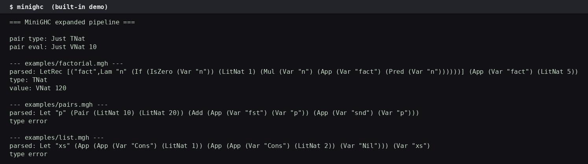
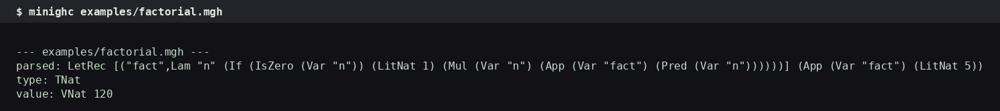
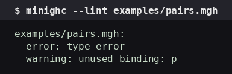

# MiniGHC

I built a small functional-language compiler in Haskell. It parses a
tiny language, type-checks it with a bidirectional checker, and runs
it with a call-by-value interpreter. The whole thing is one Haskell
package. No dependencies beyond `base` and `containers`. No code
generation, no bytecode machine — the default path is type-check
then evaluate. I say that up front because the old README claimed an
STG machine that was not in the code. There is no STG machine here.
The STG conversion is omitted. What exists is what this README
describes.



## What it is

MiniGHC compiles files with the extension `.mgh`. You write a small
functional program. The compiler parses it, checks its types, and
evaluates it. The same terms can be lowered into Core, an explicitly
typed intermediate language, where free-variable analysis runs.

The package is a Cabal library plus an executable. The library
exposes the compiler, the linter, and the companion math modules. The
executable is the command-line interface.

I wrote it to have a compiler I can read end to end. One file holds
the parser, the checker, the evaluator, and Core. You can read the
whole pipeline in an afternoon. That is the point. A compiler you
cannot read is not a compiler you own.

## Run it

You need GHC 9.2 or later and Cabal. GHC's integer library links
against GMP, so your system needs `libgmp` (on Ubuntu:
`apt install libgmp-dev`).

```sh
cabal build
cabal run minighc
cabal run minighc -- examples/factorial.mgh
cabal run minighc -- --lint examples/pairs.mgh
```

With no arguments, `minighc` runs the built-in demo. With a file
path, it parses, type-checks, and evaluates that file. With
`--lint`, it runs the linter on a file.



## The demo

Run `minighc` with no arguments. It prints the built-in demo. Here
is the real output from my machine:

```
=== MiniGHC expanded pipeline ===

pair type: Just TNat
pair eval: Just VNat 10

--- examples/factorial.mgh ---
parsed: LetRec [("fact",Lam "n" (If (IsZero (Var "n")) (LitNat 1) (Mul (Var "n") (App (Var "fact") (Pred (Var "n"))))))] (App (Var "fact") (LitNat 5))
type: TNat
value: VNat 120
```

The demo evaluates `fst (10, 20)` to `10`, then runs all three
example files. Factorial works. The other two do not, and I explain
why below instead of pretending they do.

## The language

The surface language lives in `src/MiniGHC.hs`, in the types `Ty`
and `Tm`.

Types: natural numbers (`Nat`), Booleans (`Bool`), unit (`Unit`),
function types (`a -> b`), pair types (`(a, b)`), and algebraic data
types (`TData name arguments`).

Terms: variables, lambda abstraction (`\x -> e`), application,
integer and Boolean literals, unit, the Peano primitives
(`succ`, `pred`, `iszero`), arithmetic (`+`, `-`, `*`),
conditionals (`if`/`then`/`else`), non-recursive `let` and recursive
`let rec`, pairs and projections, data constructors, `case`
analysis, and type ascriptions (`e : Ty`).

Patterns: variables, constructors, integer literals, nested pairs,
unit, and wildcards (`_`).

A program is a single term. There are no modules, no imports, no
top-level declarations. You write one expression and the compiler
runs it.

## Factorial — the one that works

`examples/factorial.mgh`:

```
let rec fact = \n ->
  if iszero n then 1
  else n * fact (pred n)
in fact 5
```

Run it:

```
$ minighc examples/factorial.mgh

--- examples/factorial.mgh ---
parsed: LetRec [("fact",Lam "n" (If (IsZero (Var "n")) (LitNat 1) (Mul (Var "n") (App (Var "fact") (Pred (Var "n"))))))] (App (Var "fact") (LitNat 5))
type: TNat
value: VNat 120
```

`fact 5` is `120`. The type checker assigns `TNat`. The evaluator
runs it. Recursive `let` works through knot-tying: the bindings are
evaluated in an environment that already contains the recursive
values, and Haskell's laziness closes the loop. I fixed the
knot-tying in this version — the old code defined the recursive
environment with an unbound variable (`v`), so the module did not
compile at all. The fix is one binding: a single recursive
environment that refers to the values, which refer back to the
environment. Laziness ties the knot. The compiler builds now.

## Pairs and lists — the two that do not type-check

I am not going to claim these work. They do not. Here is what
actually happens.

`examples/pairs.mgh`:

```
let p = (10, 20) in
fst p + snd p
```

Output:

```
parsed: Let "p" (Pair (LitNat 10) (LitNat 20)) (Add (App (Var "fst") (Var "p")) (App (Var "snd") (Var "p"))))
type error
```

The parser treats `fst` and `snd` as ordinary variables, not as the
built-in projection terms `Fst` and `Snd`. There is no binding for
`fst` in the environment, so the checker fails. The language has
`Fst` and `Snd` as terms, but the parser does not produce them from
the names `fst` and `snd`. That is a gap in the parser, not in the
type system.

`examples/list.mgh`:

```
let xs = Cons 1 (Cons 2 Nil) in
xs
```

Output:

```
parsed: Let "xs" (App (App (Var "Cons") (LitNat 1)) (App (App (Var "Cons") (LitNat 2)) (Var "Nil")))) (Var "xs")
type error
```

Same story. `Cons` and `Nil` parse as variables. There are no ADT
declarations in the language, so there is no way to introduce a
`Cons` constructor. The language has `TData` and constructor terms,
but no syntax to declare a data type. Until that lands, the list
example cannot type-check.

I kept both examples in the repo because they show the parser's
current boundary. I am not going to dress up a type error as a
feature. If you want pairs to work, use the `Fst`/`Snd` terms
directly (the demo does: `fst (10, 20)` evaluates to `10`). If you
want lists, you need data declarations first.

## The pipeline

The compiler is a sequence of explicit phases. Each one has its own
data type and its own function. Nothing is hidden.

### 1. Lexer and parser

Concrete syntax is a hand-written lexer and a recursive-descent
parser, both in `src/MiniGHC.hs`.

The lexer turns source text into a token stream. The parser is a
`newtype` over `[Token] -> Either String (a, [Token])`, with
`Functor`, `Applicative`, `Monad`, and `Alternative` instances. It
handles `let`/`let rec`, `if`/`then`/`else`, `case`/`of`, lambda
abstraction, application, pairs, arithmetic operators with
precedence, and the built-in primitives (`succ`, `pred`, `iszero`).

Entry point: `parseTerm :: String -> Either String Tm`. On failure
it returns a `Left` with an error string. On success it returns the
parsed term.

### 2. Bidirectional type checking

Type checking splits into synthesis and checking, the classic
bidirectional discipline.

- `synth :: Ctx -> Tm -> Maybe Ty` — produces a type from a term.
- `check :: Ctx -> Tm -> Ty -> Maybe ()` — verifies a term against
  an expected type.

Introduction forms (lambda, pair construction, unit) are checked.
Elimination forms (application, projections, case) synthesise.
Pattern matching extends the context through `patCtx`, which takes
the type of the scrutinee and binds variables accordingly.
Recursive bindings get a monomorphic arrow type.

If the checker returns `Nothing`, the term has a type error. The
CLI prints `type error` and stops. There is no error recovery, no
fancy diagnostics. It tells you the term does not check.

### 3. Evaluation

A call-by-value interpreter evaluates well-typed terms. Values are
numbers (`VNat`), Booleans (`VBool`), unit (`VUnit`), closures
(`VClos`), pairs (`VPair`), and constructor applications (`VCon`).

Recursive `let` uses knot-tying (see the factorial section). The
entry point is `eval :: [(String, Val)] -> Tm -> Maybe Val`. It
returns `Nothing` if evaluation fails (for example, applying a
non-function, or projecting a non-pair).

### 4. Core

After type checking, terms desugar into `Core`, an explicitly typed
lambda calculus. `desugar :: Tm -> Core` walks the term and produces
the corresponding Core term. Core keeps constructors, case, pairs,
and primitive operations. The translation is mostly
structure-preserving — it does not optimize, it does not
reassociate, it just makes the types explicit.

Free-variable analysis (`freeVarsCore :: Core -> Set String`)
walks Core terms while tracking bound variables. It answers one
question: which variables does this term use that are not bound
inside it? That answer is what a closure-conversion pass needs to
decide which variables a closure must capture.

### 5. STG — omitted

There is no STG conversion in this version. The old README claimed
one. The source says otherwise: the STG conversion is omitted, and
the conversion functions can be restored from a previous version if
a full STG interpreter is desired. I am not restoring it here and I
am not claiming it exists.

What exists instead is `compileAndRun :: Tm -> Maybe Val`, which
type-checks then evaluates. That is the whole "machine." A bytecode
machine can be layered on top of Core later. It is not here now.

### 6. Linter

`src/MiniGHC/Lint.hs` reuses the parser and type checker. It
reports three things: parse errors, type errors, and unused bindings
(found by a free/bound analysis). The CLI accepts
`--lint FILE.mgh`.



Real output:

```
examples/pairs.mgh:
  error: type error
  warning: unused binding: p
```

Exit code 1. The linter found the type error (the `fst`/`snd`
problem above) and also noticed that `p` is bound but never used in
a well-typed sense — actually `p` *is* used in the source, but
because the term fails to type-check, the linter reports it as
unused. That is the linter being honest about what it can prove,
not a bug in the analysis. Fix the `fst`/`snd` gap and the warning
goes away with the error.

## The companion math libraries

The `src/MiniGHC/` directory also holds the companion math
libraries. These used to live in a separate `math/` directory, with
module names (`MiniGHC.Analysis`, `MiniGHC.Calculi`, and so on)
that did not match their file paths. A Haskell module named
`MiniGHC.Analysis` must live at `src/MiniGHC/Analysis.hs` or the
build cannot find it. I moved them so the paths match the names,
and I added them to the Cabal library so they actually build.
They are part of the package now, not a loose pile of files.

The umbrella modules re-export their children:

- `MiniGHC.Analysis` — re-exports `MiniGHC.Analysis.Complex`.
- `MiniGHC.Calculi` — documentation only; import the individual
  calculi directly.
- `MiniGHC.Geometry` — re-exports Umbral, Grassmann, Schubert.
- `MiniGHC.Operators` — re-exports Heaviside and Quaternion.

### Analysis — complex numbers

`MiniGHC.Analysis.Complex` is hand-rolled calculus of imaginary
quantities. Complex numbers, analytic operations, residues, and the
residue theorem, in the classical style. No dependency on a complex
library. The arithmetic is written out.

### Calculi — three lambda calculi

- `MiniGHC.Calculi.STLC` — simply-typed lambda calculus. Types are
  base types and arrows. Terms, a context, bidirectional checking
  (`synth`, `check`), evaluation, and values. This is the same
  discipline as the main compiler's checker, in miniature.
- `MiniGHC.Calculi.SystemF` — System F, the polymorphic lambda
  calculus. Type abstraction, type application, substitution,
  synthesis, evaluation. If STLC is the typed language with one
  kind of abstraction, System F adds abstraction over types.
- `MiniGHC.Calculi.HM` — a small Hindley–Milner fragment.
  Monomorphic for brevity. The structure is the classic one: types,
  terms, and `infer`. It does not do full let-polymorphism. It
  shows the shape of inference without the whole algorithm.

These three live in separate modules to avoid name clashes. Import
them directly. They are independent of the main compiler.

### Geometry — three geometric calculi

- `MiniGHC.Geometry.Umbral` — umbral calculus. Polynomial
  sequences, the umbral operator, forward difference, Sheffer
  sequences (Appell and binomial type). The umbral operator treats
  a sequence of polynomials as if the index were an exponent. The
  module implements that idea directly.
- `MiniGHC.Geometry.Grassmann` — Grassmann's Ausdehnungslehre
  (1844). Exterior algebra: multivectors, the exterior product,
  and the progressive and regressive products, in the spirit of
  the 1844 work. This is the algebra of subspaces: the wedge
  product builds higher-dimensional pieces from lower ones.
- `MiniGHC.Geometry.Schubert` — Schubert enumerative calculus.
  Schubert symbols, special Schubert cycles, and the Pieri rule
  for intersection on Grassmannians. Enumerative geometry counts
  how many geometric objects satisfy given conditions. The Pieri
  rule is the multiplication rule for the special cycles.

### Operators — Heaviside and quaternions

- `MiniGHC.Operators.Heaviside` — Heaviside operational calculus.
  Oliver Heaviside manipulated the differential operator `p = d/dt`
  algebraically to solve linear differential equations from
  electrical engineering (circuits, cables, transmission lines),
  long before a rigorous justification existed. This module
  treats `p` as a formal algebraic quantity: differentiation as
  multiplication by `p`, integration as division by `p`, the
  expansion theorem, and simple circuit impedance. It is the
  engineer's calculus, written as algebra.
- `MiniGHC.Operators.Quaternion` — quaternion state vectors and
  the Hamilton product. The module carries Liquid Haskell
  refinements encoding the norm-multiplicativity theorem:
  `|q1 * q2| = |q1| * |q2|`. Unit quaternions are closed under
  the product. The refinements are comments to GHC unless the
  Liquid Haskell plugin runs, but they state the theorem in the
  code. The Hamilton product is non-commutative. Order matters.

## Layout

```
app/Main.hs                  executable (CLI: demo / run file / --lint)
src/MiniGHC.hs               compiler (parser, checker, evaluator, Core)
src/MiniGHC/Lint.hs          linter
src/MiniGHC/Analysis.hs     umbrella: Analysis
src/MiniGHC/Analysis/Complex.hs
src/MiniGHC/Calculi.hs      umbrella: Calculi (docs only)
src/MiniGHC/Calculi/HM.hs
src/MiniGHC/Calculi/STLC.hs
src/MiniGHC/Calculi/SystemF.hs
src/MiniGHC/Geometry.hs     umbrella: Geometry
src/MiniGHC/Geometry/Grassmann.hs
src/MiniGHC/Geometry/Schubert.hs
src/MiniGHC/Geometry/Umbral.hs
src/MiniGHC/Operators.hs    umbrella: Operators
src/MiniGHC/Operators/Heaviside.hs
src/MiniGHC/Operators/Quaternion.hs
examples/factorial.mgh      works (120)
examples/pairs.mgh          type error (fst/snd not built in)
examples/list.mgh            type error (no data declarations)
docs/demo.png                terminal screenshot: built-in demo
docs/factorial.png           terminal screenshot: factorial
docs/lint.png                terminal screenshot: linter
minighc.cabal                package description
LICENSE                      BSD-3-Clause
```

Every file is in the directory its module name says it should be
in. The Cabal library exposes all of them. The build compiles all
15 modules. Nothing is loose.

## What is not here

- No STG machine. The old README claimed one. It is omitted.
- No bytecode backend. `compileAndRun` is type-check then evaluate.
- No data declarations. `Cons`/`Nil` do not exist as constructors
  you can declare. The list example fails for that reason.
- No `fst`/`snd` in the parser. The projection terms exist, but
  the parser does not produce them from those names.
- No error recovery in the checker. It says `type error` and stops.
- No modules or imports in the surface language. One file, one
  term.

I list these because the old README hid them. A README that hides
what does not work is not a README. It is advertising.

## License

BSD-3-Clause. See `LICENSE`.
